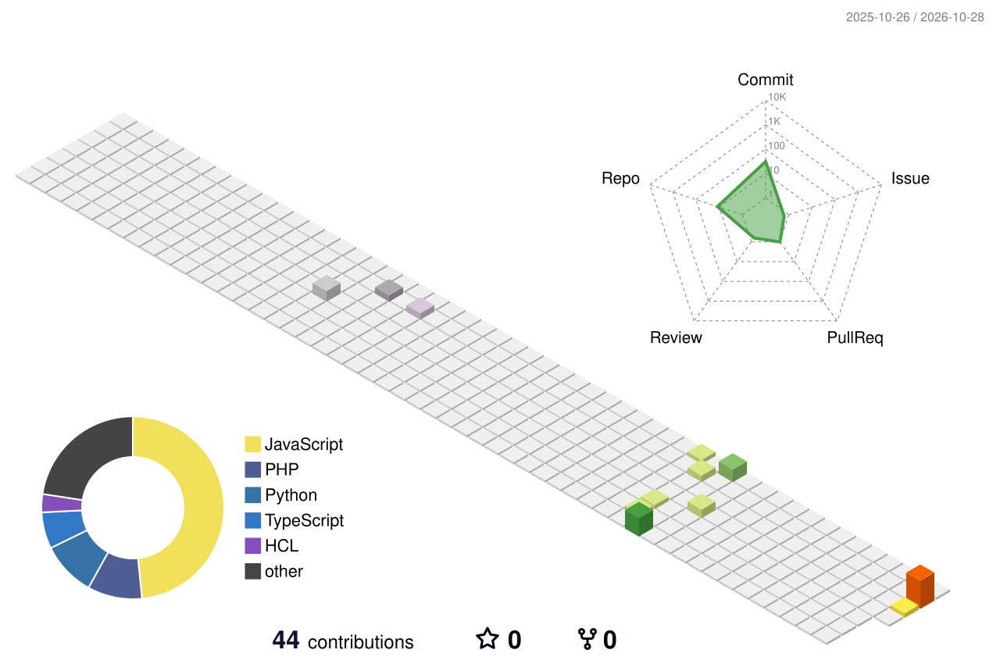

  

  

  

  

  
  
  

---

### About

| In plain words | For engineers |
| --- | --- |
| I help teams release software without late-night surprises. Same steps every time, checks before it goes live, and a clear signal when something is wrong. | CI/CD, Terraform, Kubernetes, Prometheus/Grafana, shell automation, and pipelines that fail closed on security scans. |

- DevOps Engineer · security-minded delivery
- Ahmedabad, Gujarat, India

---

### Featured work

  
  

  
  

---

### Stack

  

---

### Motion on this page

These pieces move on their own. GitHub Actions refreshes the calendar and the snake every day.

  

  

  
  

  

  

  <picture>
    <source media="(prefers-color-scheme: dark)" srcset="https://raw.githubusercontent.com/yashkapadi12/yashkapadi12/output/github-contribution-grid-snake-dark.svg" />
    
  </picture>

---

  
  
  

  

  

